# Attendance Tracker Architecture

## System Overview

The Attendance Tracker is a client-server application designed to simplify classroom attendance tracking for professors. The system consists of:

- **Backend**: A Rust-based Actix-web server (Rust Edition 2024) with SQLite database
- **Frontend**: A Next.js 15 application with React 19 and TailwindCSS 4
- **Communication Layer**: REST APIs and WebSockets for real-time updates
- **Security Layer**: CSRF protection, rate limiting, input sanitization, and PII protection

The application runs as a local service that provides a dashboard for professors and an attendance submission form for students.

## Core Components

```mermaid
    graph TD
        %% Main Components
        Frontend[Frontend Application]
        Backend[Backend Server]
        Database[(SQLite Database)]

        %% Frontend Components
        Dashboard[Dashboard Components]
        AttendanceForm[Attendance Form]
        CourseManagement[Course Management]
        FrontendServices[Services Layer]
        UIComponents[UI Components - Radix]
        StateManagement[State Management - Context]
        Providers[Providers - CSRF & Toast]

        %% Backend Components
        APILayer[API Layer]
        Middleware[Middleware Layer]
        DBLayer[Database Layer]
        Models[Data Models]
        Services[Background Services]
        Utils[Utility Layer]
        ErrorHandling[Error Handling]

        %% Connections
        Frontend -- "HTTP/WebSocket" --> Middleware
        Middleware --> Backend
        Backend --> Database

        %% Frontend Breakdown
        Frontend --> Dashboard
        Frontend --> AttendanceForm
        Frontend --> CourseManagement
        Frontend --> FrontendServices
        Frontend --> UIComponents
        Frontend --> StateManagement
        Frontend --> Providers

        %% Backend Breakdown
        Middleware --> APILayer
        Backend --> APILayer
        Backend --> DBLayer
        Backend --> Models
        Backend --> Services
        Backend --> Utils
        Backend --> ErrorHandling

        %% Detailed Connections
        Dashboard -- "WebSocket" --> APILayer
        Dashboard -- "REST API" --> APILayer
        AttendanceForm -- "REST API" --> APILayer
        CourseManagement -- "REST API" --> APILayer
        FrontendServices -- "REST API" --> APILayer
        StateManagement -- "Manages" --> Dashboard
        StateManagement -- "Manages" --> CourseManagement
        Providers -- "Initializes" --> FrontendServices

        APILayer --> DBLayer
        APILayer --> Models
        APILayer --> Services
        APILayer --> Utils
        DBLayer --> Database
        Services -- "Real-time Updates" --> APILayer
        Middleware -- "Protection" --> APILayer

        %% Component Details
        subgraph "Frontend (Next.js 15 + React 19)"
            Dashboard
            AttendanceForm
            CourseManagement
            FrontendServices
            UIComponents
            StateManagement
            Providers
        end

        subgraph "Backend (Rust 2024 + Actix-web 4)"
            Middleware
            APILayer
            DBLayer
            Models
            Services
            Utils
            ErrorHandling
        end

        %% Labels
        class Frontend,Backend,Database highlightNode
        class Dashboard,AttendanceForm,CourseManagement,FrontendServices,UIComponents,StateManagement,Providers frontendNode
        class Middleware,APILayer,DBLayer,Models,Services,Utils,ErrorHandling backendNode

        classDef highlightNode fill:#f9f,stroke:#333,stroke-width:2px
        classDef frontendNode fill:#d4f4fa,stroke:#333,stroke-width:1px
        classDef backendNode fill:#ffe6cc,stroke:#333,stroke-width:1px
```

### 1. Backend Server

The backend is built with Rust (Edition 2024) using the Actix-web 4.11 framework and provides:

#### Key Components

1. **Middleware Layer** (`back-end/src/middleware/`)

   - **CSRF Protection** (`csrf_protection.rs`): Double-submit cookie pattern for CSRF prevention
   - **Host-Only Middleware** (`host_only.rs`): Restricts administrative endpoints to localhost only
   - Applied selectively to endpoints based on security requirements

2. **API Layer** (`back-end/src/api/`)

   - **Attendance** (`attendance.rs`): Endpoints for submitting and viewing attendance records
   - **Auth** (`auth.rs`): CSRF token generation and validation endpoints
   - **Confirmation Codes** (`confirmation_codes.rs`): Time-limited code generation for attendance verification
   - **Courses** (`courses.rs`): Full course CRUD operations and management
   - **Export** (`export.rs`): CSV export functionality for attendance data
   - **Preferences** (`preferences.rs`): User preferences and settings management
   - **QR Code** (`qrcode.rs`): Dynamic QR code generation for attendance forms
   - **Upload** (`upload.rs`): File upload handling for course logos
   - **WebSocket** (`ws.rs`): Real-time attendance updates via WebSocket connections
   - Public and host-only endpoints with different access restrictions

3. **Database Layer** (`back-end/src/db/`)

   - SQLite database with tables for courses, attendance records, preferences, device tracking
   - **Attendance** (`attendance.rs`): Attendance record queries and management
   - **Courses** (`courses.rs`): Course data access and manipulation
   - **Device Submissions** (`device_submissions.rs`): Track submissions per device to prevent duplicates
   - **Preferences** (`preferences.rs`): Application preferences storage
   - Connection pooling with SQLx for efficient database access

4. **Models** (`back-end/src/models/`)

   - **Course** (`course.rs`): Course data structures with sections and metadata
   - **Attendance** (`attendance.rs`): Attendance record representations
   - **Preferences** (`preferences.rs`): User preference models
   - Serialization/deserialization with Serde for API communication
   - Input validation with the validator crate

5. **Services** (`back-end/src/services/`)

   - **Confirmation Code Service** (`confirmation_codes.rs`): Periodic generation and rotation of time-limited codes
   - **CSRF Service** (`csrf.rs`): CSRF token store with automatic cleanup of expired tokens
   - **Rate Limiter** (`rate_limiter.rs`): Per-device rate limiting to prevent spam submissions
   - **WebSocket Server** (`ws_server.rs`): Actor-based WebSocket server for real-time updates with heartbeat mechanism
   - Background tasks run asynchronously to support main application flow

6. **Utility Layer** (`back-end/src/utils/`)

   - **Sanitization** (`sanitize.rs`): Input sanitization to prevent injection attacks
   - **PII Protection** (`pii.rs`): Hash sensitive data (student IDs, names) in logs for privacy

7. **Error Handling** (`back-end/src/errors.rs`)

   - Centralized error handling with custom error types
   - Automatic conversion to appropriate HTTP responses
   - Consistent error formatting for API consumers
   - Integration with thiserror for error derivation

8. **Configuration** (`back-end/src/config.rs`)
   - Application settings loaded from environment variables
   - Database connection configuration
   - Server host and port settings

9. **Application State** (`back-end/src/main.rs`)
   - Shared state across all handlers:
     - Database connection pool
     - Configuration
     - WebSocket server address
     - Active host course ID tracker
     - Attendance rate limiter
     - CSRF token store

### 2. Frontend Application

The frontend is built with Next.js 15.4.7 and React 19.2.0, using TailwindCSS 4.1.14 for styling:

#### Key Components

1. **State Management** (`web-ui/app/context/`)

   - **CourseContext** (`CourseContext.tsx`): Centralized course state management
     - Manages course data, preferences, and settings
     - Provides actions for creating, updating, switching, and deleting courses
     - Handles loading states and error handling
     - Uses React's useReducer for predictable state updates

2. **Pages**

   - **Dashboard** (`web-ui/app/page.tsx`): Professor view for monitoring and managing attendance
   - **Attendance Form** (`web-ui/app/attendance/page.tsx`): Student-facing form for submitting attendance

3. **Dashboard Components** (`web-ui/app/components/dashboard/`)

   - **AttendanceCounter**: Real-time attendance count display with percentage
   - **ConfirmationCode**: Dynamic confirmation code display with refresh timer
   - **CourseHeader**: Course title and section information
   - **CourseNews**: Announcement/news display for students
   - **DashboardFooter**: Footer with export and additional actions
   - **DashboardLayout**: Main layout wrapper for dashboard
   - **QRCodeDisplay**: QR code generation and display for easy student access
   - **SectionSelector**: Interface for switching between course sections

4. **Course Management Components** (`web-ui/app/components/course-management/`)

   - **CourseCreationWizard**: Multi-step course creation interface
   - **CourseLibraryModal**: Browse and select from existing courses
   - **CourseSettingsModal**: Edit course settings and preferences
   - **SectionManager**: Create and manage course sections

5. **UI Components** (`web-ui/app/components/ui/`)

   - Built with Radix UI primitives for accessibility and consistency:
     - `alert-dialog.tsx`: Confirmation dialogs
     - `button.tsx`: Button component with variants
     - `card.tsx`: Card container component
     - `dialog.tsx`: Modal dialogs
     - `form.tsx`: Form components with validation
     - `input.tsx`, `textarea.tsx`, `select.tsx`: Form inputs
     - `label.tsx`: Form labels
     - `badge.tsx`: Status badges
     - `separator.tsx`: Visual separators
     - `tabs.tsx`: Tabbed interfaces
     - `scroll-area.tsx`: Custom scrollable areas
     - `sonner.tsx`: Toast notification wrapper
   - `LogoUploader.tsx`: Custom logo upload and preview component

6. **Providers** (`web-ui/app/components/`)

   - **CsrfTokenInitializer**: Fetches and stores CSRF token on app initialization
   - **ToasterProvider**: Provides toast notification system throughout the app

7. **Services** (`web-ui/app/services/`)

   - **preferencesService** (`preferencesService.ts`): Course preferences management
     - CRUD operations for courses
     - Local storage synchronization
     - Course switching logic
   - **confirmationCodeService** (`confirmationCodeService.ts`): Fetches current confirmation code
   - **csrfService** (`csrfService.ts`): CSRF token management and storage

8. **Icons** (`web-ui/app/components/icons/`)
   - Custom icon components using lucide-react library

### 3. Communication Flow

1. **REST API**

   - **Course Management**: CRUD operations for courses and sections
   - **Preferences**: Save and retrieve user preferences
   - **Attendance**: Submit and query attendance records
   - **File Uploads**: Logo uploads with multipart form handling
   - **QR Code Generation**: Dynamic QR codes based on course information
   - **Export**: CSV export of attendance data
   - **CSRF Protection**: Token generation and validation
   - All requests protected by CSRF tokens (except public endpoints)

2. **WebSockets**

   - Real-time attendance count updates to the dashboard
   - Actor-based server implementation with Actix
   - Connection management with heartbeat mechanism
   - Automatic cleanup of stale connections
   - Broadcasts updates to all connected clients when attendance changes

3. **Confirmation Codes**

   - Temporary 6-digit codes generated by the backend
   - Used to verify attendance submissions are happening during class time
   - Refreshed every 30 seconds for security
   - Only valid for the current time window
   - Progress indicator shows time remaining before refresh

4. **Security Mechanisms**

   - **CSRF Tokens**: Double-submit cookie pattern
   - **Rate Limiting**: Per-device limits on attendance submissions using actix-governor
   - **Input Sanitization**: All user inputs sanitized before processing
   - **Host-Only Routes**: Administrative functions restricted to localhost
   - **Device Tracking**: Prevents duplicate submissions from same device

## Key Technical Decisions

### 1. Rust Edition 2024 Backend

- **Why**: Performance, memory safety, and low resource usage
- **Benefits**:
  - Fast startup time and efficient handling of concurrent requests
  - Strong type system prevents many classes of bugs at compile time
  - Zero-cost abstractions for high-level code without performance penalty
  - Modern edition features for improved ergonomics

### 2. SQLite Database with SQLx

- **Why**: Simplicity, portability, no external dependencies
- **Benefits**:
  - Self-contained database file, easy to distribute
  - No separate database server needed
  - Compile-time checked queries with SQLx macros
  - Connection pooling for efficient resource usage

### 3. Actix-web 4 Framework

- **Why**: High-performance async web framework for Rust
- **Benefits**:
  - Excellent concurrency support with Tokio runtime
  - Modular architecture with middleware support
  - Built-in WebSocket support via actix-web-actors
  - Actor model for managing stateful components

### 4. Next.js 15 Frontend with React 19

- **Why**: Modern React framework with cutting-edge features
- **Benefits**:
  - App Router for improved routing and layouts
  - Fast page loads with automatic code splitting
  - Great developer experience with hot module replacement
  - TypeScript support for type safety

### 5. Radix UI Components

- **Why**: Need for accessible, unstyled component primitives
- **Benefits**:
  - WAI-ARIA compliant components out of the box
  - Headless components allow full styling control
  - Excellent keyboard navigation and screen reader support
  - Consistent behavior across browsers

### 6. TailwindCSS 4

- **Why**: Utility-first CSS framework for rapid UI development
- **Benefits**:
  - Consistent styling with design tokens
  - Responsive design made simple
  - Minimal CSS footprint with JIT compilation
  - Easy customization and theming

### 7. React Hook Form + Zod

- **Why**: Type-safe form handling with validation
- **Benefits**:
  - Minimal re-renders for better performance
  - Schema-based validation with TypeScript inference
  - Easy integration with Radix UI components
  - Clear error handling and display

### 8. WebSockets for Real-time Updates

- **Why**: Need for immediate attendance count updates
- **Benefits**:
  - Efficient push-based updates without polling
  - Reduced server load compared to HTTP polling
  - Actor-based implementation for reliable message delivery
  - Heartbeat mechanism prevents stale connections

### 9. CSRF Protection with Double-Submit Cookie

- **Why**: Prevent cross-site request forgery attacks
- **Benefits**:
  - No server-side session storage required
  - Works well with stateless API design
  - Automatic token rotation and cleanup
  - Frontend-friendly implementation

### 10. Rate Limiting with Actix-Governor

- **Why**: Prevent spam and abuse of attendance endpoints
- **Benefits**:
  - Per-device limiting prevents bulk submissions
  - Configurable limits per endpoint
  - Minimal performance overhead
  - Automatic cleanup of expired rate limit entries

### 11. Input Sanitization and PII Protection

- **Why**: Security and privacy compliance
- **Benefits**:
  - Prevents injection attacks through sanitized inputs
  - Student data hashed in logs for privacy
  - Regex-based validation for all user inputs
  - Centralized sanitization logic for consistency

### 12. Confirmation Codes

- **Why**: Ensure attendance is taken during class time only
- **Benefits**:
  - Prevents students from marking attendance remotely
  - Time-limited codes add security layer
  - Automatic rotation every 30 seconds
  - Visual progress indicator for transparency

### 13. QR Codes

- **Why**: Easy access to the attendance form
- **Benefits**:
  - Students don't need to manually enter URLs
  - Reduces friction in attendance process
  - Works on any device with a camera
  - Dynamic generation based on course context

## Data Flow

1. **Application Initialization**:

   - Backend starts and creates database connection pool
   - Initializes WebSocket server actor
   - Starts background services (confirmation code generator, CSRF cleanup, rate limiter cleanup)
   - Seeds default course if database is empty
   - Frontend loads and fetches CSRF token
   - CourseContext initializes with current course from preferences

2. **Professor Setup**:

   - Professor creates/selects a course through CourseCreationWizard or CourseLibraryModal
   - Frontend sends course data to backend with CSRF token
   - Backend validates, sanitizes input, and stores in database
   - QR code generated dynamically based on course URL
   - Confirmation code generated and refreshed every 30 seconds
   - Dashboard displays all course information and attendance tools

3. **Student Attendance Submission**:

   - Student scans QR code to access attendance form with course context
   - Form loads with course information pre-filled
   - Student enters name, ID, and current confirmation code
   - Frontend validates input with Zod schema
   - Backend receives submission and performs:
     - CSRF token validation
     - Rate limit check for device
     - Input sanitization
     - Confirmation code verification
     - Duplicate device check
   - If valid, backend records attendance in database
   - WebSocket server broadcasts update to all connected dashboard clients
   - Student sees success notification, professor sees real-time count update

4. **Real-time Updates**:

   - Dashboard establishes WebSocket connection on load
   - Backend maintains connection with periodic heartbeat
   - On each attendance submission, WebSocket broadcasts new count
   - Dashboard updates attendance counter without page refresh
   - Confirmation code updates automatically with visual progress indicator

5. **Attendance Monitoring and Export**:

   - Professor views real-time attendance count with percentage on dashboard
   - Can switch between course sections to view section-specific data
   - Export functionality generates CSV file with all attendance records
   - Backend queries database and formats as CSV
   - File downloads with sanitized filename including course and date

## Security Considerations

The application implements multiple layers of security to protect against common web vulnerabilities and ensure data integrity:

### 1. CSRF Protection

- **Implementation**: Double-submit cookie pattern
- **Mechanism**:
  - Backend generates unique CSRF tokens on request
  - Tokens stored in memory with expiration timestamps
  - Frontend includes token in both cookie and request header
  - Backend validates token match before processing requests
- **Coverage**: All state-changing endpoints (POST, PUT, DELETE)
- **Automatic Cleanup**: Expired tokens removed periodically to prevent memory bloat

### 2. Host-Only Middleware

- **Purpose**: Restrict administrative functions to localhost only
- **Protected Routes**:
  - Course management (create, update, delete)
  - Preferences modifications
  - File uploads
  - Data exports
- **Mechanism**: Validates request IP address is 127.0.0.1 or ::1
- **Benefits**: Prevents unauthorized access even on local network

### 3. Rate Limiting

- **Library**: actix-governor
- **Scope**: Per-device (based on device fingerprint)
- **Limits**: Configurable per-endpoint
- **Purpose**: Prevent spam submissions and abuse
- **Storage**: In-memory with automatic cleanup
- **Response**: 429 Too Many Requests when limit exceeded

### 4. Input Sanitization

- **Layer**: Utils layer (`sanitize.rs`)
- **Scope**: All user inputs (names, IDs, course info, news)
- **Techniques**:
  - Regex-based validation
  - Whitelist approach for allowed characters
  - Length limits enforced
  - HTML/script tag removal
- **Benefits**: Prevents injection attacks (XSS, SQL injection)

### 5. PII Protection

- **Layer**: Utils layer (`pii.rs`)
- **Purpose**: Protect student privacy in logs
- **Implementation**:
  - SHA-256 hashing of sensitive data (student names, IDs)
  - Only hashes appear in logs, not actual data
  - One-way hashing prevents recovery
- **Compliance**: Helps meet privacy regulations

### 6. Device Tracking

- **Purpose**: Prevent duplicate attendance submissions
- **Implementation**:
  - Unique device fingerprint stored with each submission
  - Database table tracks device-course-date combinations
  - Prevents same device from submitting multiple times
- **Privacy**: Device ID not linked to student identity

### 7. Confirmation Codes

- **Purpose**: Ensure attendance taken during class time only
- **Implementation**:
  - 6-digit random codes generated every 30 seconds
  - Stored in application state, not database
  - Only current code is valid
  - Previous codes immediately invalidated
- **Benefits**: Prevents remote attendance marking

### 8. Input Validation

- **Backend**: Validator crate for struct validation
- **Frontend**: Zod schemas with react-hook-form
- **Coverage**:
  - Field presence validation
  - Type checking
  - Format validation (e.g., student ID patterns)
  - Length constraints
- **Benefits**: Defense in depth - validation on both ends

### 9. Database Security

- **SQL Injection Prevention**: SQLx compile-time checked queries
- **Parameterized Queries**: All user inputs passed as parameters
- **Connection Pooling**: Controlled database connections
- **File Permissions**: Database file protected by OS permissions

### 10. Local Network Only

- **Design**: Application intended for local network deployment
- **Configuration**: Binds to local IP address only
- **Benefits**:
  - Not exposed to internet by default
  - Reduced attack surface
  - Suitable for classroom environment

### 11. Error Handling

- **Implementation**: Centralized error handling in `errors.rs`
- **Privacy**: Generic error messages to clients (no stack traces)
- **Logging**: Detailed errors logged server-side only
- **Status Codes**: Appropriate HTTP status codes for different errors

## Scalability

The application is designed for classroom-scale usage (typically 20-300 students per class) and can handle concurrent attendance submissions through:

### Performance Optimizations

1. **Asynchronous Architecture**

   - Tokio runtime for efficient async I/O
   - Non-blocking request handling allows concurrent processing
   - Actor model for WebSocket server isolates connection management
   - Background services run independently without blocking main thread

2. **Database Efficiency**

   - SQLx connection pooling prevents connection exhaustion
   - Indexed columns for fast lookups (course_id, student_id, dates)
   - Compile-time checked queries eliminate runtime parsing overhead
   - Batch operations where possible

3. **WebSocket Optimization**

   - Actor-based design scales to many concurrent connections
   - Heartbeat mechanism automatically removes stale connections
   - Broadcast messages efficiently distributed to all clients
   - Minimal memory footprint per connection

4. **Memory Management**

   - Rust's ownership system ensures efficient memory usage
   - Automatic cleanup services prevent memory leaks:
     - CSRF token store cleanup
     - Rate limiter entry cleanup
   - Streaming responses for large data exports (CSV)
   - LTO (Link-Time Optimization) and release optimizations in Cargo.toml

5. **Frontend Performance**

   - Next.js automatic code splitting reduces initial bundle size
   - React 19's improved reconciliation for faster re-renders
   - Memoized context values prevent unnecessary re-renders
   - Optimized state updates with useReducer pattern
   - Lazy loading of heavy components

### Tested Capacity

- **Concurrent Submissions**: Handles 50+ simultaneous attendance submissions
- **WebSocket Connections**: Supports 100+ concurrent dashboard connections
- **Database Size**: Efficiently manages years of attendance data
- **Response Times**: Sub-100ms API response times under normal load

### Bottlenecks and Limits

- **SQLite Write Concurrency**: SQLite handles one write at a time; acceptable for attendance bursts
- **Single-Machine Design**: Not distributed; limited by single machine resources
- **Local Network**: Bandwidth limited by local network infrastructure

## Future Extensions

The architecture supports several potential extensions without major refactoring:

### 1. Multi-Instructor Support

- **Implementation**: Add user authentication system
- **Changes Required**:
  - User authentication middleware (JWT or session-based)
  - User table in database with role-based access
  - Associate courses with specific instructors
  - Update host-only middleware to check user permissions
- **Benefits**: Multiple professors can manage their own courses independently

### 2. Advanced Analytics Dashboard

- **Features**:
  - Attendance trends over time (line charts)
  - Student attendance patterns (heatmaps)
  - Section comparison analytics
  - Exportable reports with visualizations
- **Implementation**:
  - New analytics API endpoints for aggregate queries
  - Charting library integration (e.g., Chart.js, Recharts)
  - Date range filtering and custom reports
- **Database**: Existing schema supports analytics with minimal additions

### 3. Student Portal

- **Features**:
  - View personal attendance history
  - Check attendance status for current class
  - Receive notifications about course updates
- **Implementation**:
  - Student authentication (simple ID-based or email)
  - New student-facing pages in Next.js
  - API endpoints for student-specific queries
- **Benefits**: Students can track their own attendance

### 4. LMS Integration

- **Target Systems**: Canvas, Moodle, Blackboard, etc.
- **Implementation**:
  - RESTful API for external systems
  - LTI (Learning Tools Interoperability) support
  - Webhook endpoints for grade synchronization
  - OAuth for secure integration
- **Data Exchange**: Attendance data → LMS gradebook

### 5. Mobile Applications

- **Approach 1**: Progressive Web App (PWA)
  - Add service worker for offline capability
  - Responsive design already in place
  - Installable on mobile devices
- **Approach 2**: React Native app
  - Reuse React components and logic
  - Native QR code scanner
  - Push notifications for professors

### 6. Attendance Verification Methods

- **Additional Options**:
  - Geolocation verification (ensure student is on campus)
  - Face recognition for automated attendance
  - Bluetooth beacons for proximity detection
  - NFC card scanning
- **Implementation**: Extensible validation chain in attendance submission handler

### 7. Email Notifications

- **Features**:
  - Email professors daily attendance summaries
  - Alert for low attendance rates
  - Remind students with poor attendance
- **Implementation**:
  - Email service integration (SMTP or API like SendGrid)
  - Background job scheduler
  - Template engine for emails

### 8. Multi-Language Support (i18n)

- **Implementation**:
  - Frontend: next-intl or react-i18next
  - Backend: accept language header, respond with localized messages
  - Translation files for supported languages
- **Benefits**: Accessibility for non-English speaking institutions

### 9. Database Migration to PostgreSQL

- **Reason**: Better concurrent write performance for larger deployments
- **Migration Path**:
  - SQLx supports both SQLite and PostgreSQL
  - Minimal code changes required
  - Migration scripts to transfer existing data
- **Benefits**: Better scalability for multi-classroom deployments

### 10. Attendance Policy Enforcement

- **Features**:
  - Configurable attendance requirements per course
  - Automatic grade calculation based on attendance
  - Warning system for students approaching limits
- **Implementation**:
  - Policy configuration in course settings
  - Background service to check compliance
  - Notification system for warnings

### 11. Audit Logging

- **Features**:
  - Log all administrative actions (course edits, deletions)
  - Track attendance modifications
  - Exportable audit trail
- **Implementation**:
  - New audit_log table
  - Middleware to capture actions
  - Admin interface to view logs
- **Benefits**: Accountability and troubleshooting

### 12. API Rate Limiting Enhancements

- **Current**: Per-device rate limiting
- **Future**:
  - Tiered rate limits by role
  - Geographic-based limiting
  - Adaptive rate limiting based on load
  - Redis-based distributed rate limiting for multi-instance deployments

## Technology Stack Summary

### Backend
- **Language**: Rust (Edition 2024)
- **Framework**: Actix-web 4.11.0
- **Runtime**: Tokio 1.47.1
- **Database**: SQLite with SQLx 0.8.6
- **Authentication**: Custom CSRF (double-submit cookie pattern)
- **WebSockets**: actix-web-actors 4.3.1
- **Rate Limiting**: actix-governor 0.6.0
- **Validation**: validator 0.19.0
- **Serialization**: serde 1.0 + serde_json 1.0
- **QR Codes**: qrcode 0.14.1
- **Image Processing**: image 0.25.8
- **Error Handling**: thiserror 2.0.17 + anyhow 1.0
- **Hashing**: sha2 0.10.8 (for PII protection)
- **Regex**: regex 1.11.1 (for sanitization)

### Frontend
- **Framework**: Next.js 15.4.7
- **Library**: React 19.2.0
- **Language**: TypeScript 5.9.3
- **Styling**: TailwindCSS 4.1.14
- **UI Components**: Radix UI (@radix-ui/react-*)
- **Forms**: react-hook-form 7.64.0
- **Validation**: zod 4.1.12
- **Notifications**: sonner 2.0.7
- **Icons**: lucide-react 0.545.0
- **Date Utilities**: date-fns 4.1.0
- **Utilities**: clsx, tailwind-merge, class-variance-authority

### Development Tools
- **Linting**: ESLint 9.37.0 with Next.js config
- **Package Manager**: npm (via package.json)
- **Build Tool**: Cargo (via Cargo.toml) for backend
- **Environment**: dotenvy 0.15.7 for env var management
